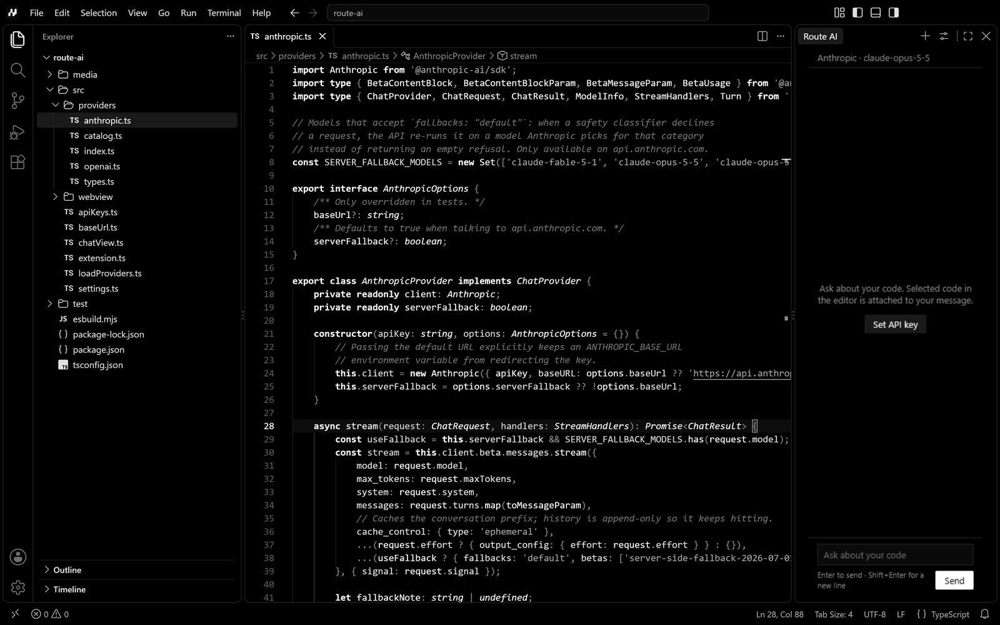

<div align="center">


# Route

**A code editor in black and white, with AI that uses your own API key.**

Route IDE is a distribution of Code - OSS, the open-source core of VS Code. It
ships a black-and-white default theme, an AI chat panel that works with your own
Anthropic, OpenAI or OpenAI-compatible API key, and leaves out the parts of the
upstream build that phone Microsoft or GitHub or slow down startup.

**Early access:** Route works, but it's new. It's Windows-only for now and
doesn't update itself yet.



</div>

## Download

Early-access builds are published as pre-releases on the
[Releases page](https://github.com/Andersxns/Route/releases) and at
[andersxn.com/route](https://andersxn.com/route/).

| File | Use it for |
|---|---|
| `Route-IDE-<version>-Setup-x64.exe` | Windows 10 and 11, 64-bit |

The installer puts Route IDE in your user account, so it doesn't need
administrator rights. It isn't code-signed yet, so SmartScreen may warn you the
first time: choose **More info → Run anyway**. Each release has a
`SHA256SUMS.txt` to check your download against.

While Route is in early access:

- There are Windows x64 builds only. macOS and Linux need more work; see
  [Known gaps](#known-gaps).
- It doesn't update itself. Install a new version over the old one; your
  settings and extensions stay.
- Some menus and messages still say "VS Code".

Please report problems and ideas in
[Issues](https://github.com/Andersxns/Route/issues).

## How this repository works

This repository is not a fork of VS Code. It contains only what Route IDE
changes. At build time those changes are applied to a pinned upstream release,
so moving to a new VS Code release means re-checking a few small patches
instead of merging a 600 MB fork.

```
distro.json          upstream tag/commit, removed extensions, publisher and URL
product.json         merged over upstream's product.json (names, IDs, Open VSX)
patches/             source patches, applied in order with git apply
extensions/
  route-ai/          AI chat panel (TypeScript, bundled with esbuild)
  route-theme/       Route Dark color theme
  route-defaults/    default settings (configurationDefaults only, no code)
branding/            logo.svg, the icons generated from it, editor watermarks
scripts/
  sync.mjs           clone or reset vscode/ to the pinned commit
  apply.mjs          apply everything above to vscode/
  build.mjs          install dependencies and package the app
  icons.mjs          render branding/logo.svg into .ico/.png/.bmp files
  check-theme.mjs    verify the theme leaves no colored UI behind
docs/                performance notes, upstream updates, releasing
```

## Building on Windows

### Prerequisites

| Tool | Notes |
|---|---|
| Git | Enable long paths once: `git config --global core.longpaths true` |
| Node.js 24 | Must match the major version in `vscode/.nvmrc` (currently 24.18.0) |
| Python 3 | Used by node-gyp |
| Visual Studio 2022 Build Tools | "Desktop development with C++" plus **MSVC v143 Spectre-mitigated libs**. Native modules are compiled against Electron during the install. |

These are upstream's requirements; see VS Code's
[How to Contribute](https://github.com/microsoft/vscode/wiki/How-to-Contribute#prerequisites)
page if something changes. The Build Tools can be installed with winget;
Windows asks for admin rights while it runs:

```bash
winget install Microsoft.VisualStudio.2022.BuildTools --override "--wait --passive --nocache --installPath D:\VSBuildTools --add Microsoft.VisualStudio.Workload.VCTools --add Microsoft.VisualStudio.Component.VC.Runtimes.x86.x64.Spectre --includeRecommended"
```

`--installPath` keeps the compiler off `C:`; the Windows SDK still goes there
(about 3 GB). The target must be a fixed drive: the Visual Studio installer
rejects removable ones, such as USB drives. Drop the option to use the default
location. `npm run build` finds the tools either way.

Plan for about 15 GB of free space on the build drive, plus the npm cache,
which lives on `C:` by default. If `C:` is short on space, move the cache:

```bash
npm config set cache D:\npm-cache
```

The build is memory-hungry (upstream allows its build process 8 GB), so close
other programs on smaller machines. For reference, the first build on a 4-core
1.1 GHz Pentium laptop, with the repository on a USB drive, took about two and
a half hours: 1 h 40 min installing dependencies (the step that compiles native
modules), 21 min compiling and packaging, and 13 min compressing the installer.
Later builds skip the install unless upstream's lockfile changes.
`.github/workflows/build.yml` runs the same steps on a GitHub-hosted runner
when started from the Actions tab; it hasn't been run yet.

### Build

```bash
npm ci
npm run sync
npm run apply
npm run build -- --installer
```

- `npm run sync` clones `microsoft/vscode` at the commit pinned in `distro.json`
  into `vscode/`. Run it again to reset that folder; it discards local changes
  there but keeps `node_modules`.
- `npm run apply` refuses to run twice on the same checkout. Run `sync` first.
- `npm run build` skips `npm ci` in `vscode/` when the lockfile has not changed.
  Pass `--skip-install` to skip it unconditionally. Native modules are compiled
  for the machine you build on, so build each platform on that platform.
- On a slow machine, split the work: `npm run build -- --install-only`, then
  `npm run build -- --installer`. After changing only `product.json` or the
  Windows and Linux icons, `npm run build -- --package-only --installer`
  repackages without recompiling.

The app is written to `VSCode-win32-x64/Route IDE.exe` (the folder keeps
upstream's name) and the user installer to `dist/route-ide-setup.exe`. The
build removes Chromium locales other than `en-US` and the source maps that
upstream only strips on its own CI.

## What Route IDE changes

| Change | Where |
|---|---|
| Name, data folders, URL protocol, installer GUIDs | `product.json` |
| Extension gallery is [Open VSX](https://open-vsx.org); the Microsoft Marketplace terms only allow Microsoft's own products | `product.json` |
| Microsoft voice endpoint and Copilot auth grants removed (`null` deletes a key); **Report Issue** opens this repository's issues | `product.json` |
| Telemetry level defaults to `off`, Microsoft experiments off | `patches/0002` |
| Built-in Copilot UI hidden (`chat.disableAIFeatures` defaults to `true`), no "Agents Window" jump list entry | `patches/0002` |
| Route Dark and the monochrome Modern file icons are the defaults; the window background is black before the theme loads | `patches/0003` |
| No Welcome page at startup. The setting is read before extensions load, so it is patched rather than contributed | `patches/0004` |
| Build tolerates the missing Copilot extension | `patches/0001` |
| Upstream's install script works when the repository path contains spaces | `patches/0005` |
| The secondary side bar starts hidden. Upstream opens it on the built-in Chat view, which is empty while AI features are off | `patches/0006` |
| Built-in extensions removed: `copilot`, `github`, `microsoft-authentication`, `tunnel-forwarding`, `grunt`, `jake`; downloaded extras `js-debug-companion`, `js-profile-table` | `distro.json` |
| Minimap off, bracket colors off, online settings search off | `extensions/route-defaults` |
| Publisher (AndersXn Technology) and links in the .exe metadata and installer, icons, title bar icon, editor watermark | `distro.json`, `branding/` |

Settings that are read before extensions load, or that are application-scoped,
are changed by patch. Everything else is a `configurationDefaults`
contribution, which never conflicts with upstream changes. Users can override
all of them.

Color themes from upstream stay installed so users can switch; Route Dark is
only the default.

The logo path in `branding/logo.svg` was traced from `branding/logo-source.png`.
If you have the original vector file, paste its path in instead. After any
logo change, run `npm run icons` to regenerate the .ico, tile, installer and
Linux images, and update the four `branding/letterpress/*.svg` watermarks,
which use the bare mark without the tile. The title bar icon is `logo.svg`
itself. The watermarks and the title bar icon are compiled into the app, so
they need a full build rather than `--package-only`.

## Route Dark

Route Dark implements the black-and-white direction from the AndersXn
Technology brief:

- All surfaces are `#000000`. Panels are separated by 1px borders
  (`#1A1A1A`/`#262626`), not by background shades.
- Text is `#E0E0E0`, active and selected items are `#FFFFFF`, and grays carry
  hierarchy (secondary text `#8C8C8C`, disabled `#5C5C5C`). Comments use
  `#767676`, which still meets WCAG AA contrast (4.6:1) on black.
- Buttons and badges are inverted: white with black text.
- Syntax is separated by weight and style instead of hue: keywords bold, types
  italic, strings `#A6A6A6`, punctuation `#8C8C8C`.
- Severity is brightness: errors white, warnings light gray, info mid gray.
  In diffs, inserted text is filled and removed text is outlined.
- Terminal ANSI colors map to a gray ladder in which red is the brightest, so
  errors in command output still stand out.
- Semantic highlighting is off. In a monochrome palette it adds almost nothing,
  and it saves the TypeScript server from computing semantic tokens.

`npm run check-theme` resolves every registered workbench color (997 in
1.140.0) the way VS Code does, and fails if any of them would render in color.
Upstream adds colors in most releases, usually blue by default, so run it after
every upstream bump.

## Route AI

A chat view in the secondary side bar (right side). Open it with `Ctrl+Alt+I`
or the **Toggle Secondary Side Bar** button in the title bar. It runs on
the stable `WebviewView` API and loads only when the view is opened.

1. Run **Route AI: Set API Key** and pick a provider.
2. Optionally run **Route AI: Select Model**, which lists the models your key
   can use.
3. Select code in the editor before sending to attach it to the message.
   Code blocks in replies have Copy and Insert buttons.

| Setting | Default | |
|---|---|---|
| `route.ai.provider` | `anthropic` | `anthropic`, `openai` or `openai-compatible` (Ollama, LM Studio, vLLM, OpenRouter, ...) |
| `route.ai.model` | empty | Empty means `claude-opus-5-5` for Anthropic; OpenAI and compatible servers need a model |
| `route.ai.baseUrl` | empty | Server for `openai-compatible`, e.g. `http://localhost:11434/v1` |
| `route.ai.maxTokens` | `16000` | Maximum reply length |
| `route.ai.effort` | empty | Anthropic thinking effort (`low` to `max`); empty uses the model default |
| `route.ai.includeSelection` | `true` | Attach the editor selection |

Security:

- API keys are stored with VS Code's SecretStorage, which encrypts them through
  the OS credential store (DPAPI on Windows). They are read only in the
  extension host and never reach the webview.
- `route.ai.provider` and `route.ai.baseUrl` are user-only settings, so a
  repository's `.vscode/settings.json` cannot redirect your key to another
  server. Plain `http` is accepted only for localhost.
- The webview runs under a strict Content Security Policy. Model output is
  rendered with markdown-it with raw HTML disabled, and remote images are
  blocked.

Anthropic specifics: replies stream; on Claude Fable 5.1, Opus 5.5, Opus 5 and
Sonnet 5.5 the request opts into server-side refusal fallback
(`fallbacks: "default"`), so if a safety classifier declines, Anthropic
re-runs the request on another model and the panel notes it; prompt caching
is on; previous replies are sent back exactly as received, because newer
models sign their thinking blocks against the unedited conversation.

The panel is a webview rather than an integration into the built-in Chat view.
The built-in view depends on proposed APIs and on the Copilot sign-in flow,
both of which change from release to release.

To work on the extension:

```bash
cd extensions/route-ai
npm ci
npm test
npm run watch
```

With `dist/` built, any VS Code-compatible editor can run it with
`--extensionDevelopmentPath=extensions/route-ai`. The Anthropic and OpenAI SDKs
are bundled into `dist/providers.js` and loaded on the first request, which
keeps the code that runs when the panel opens at about 10 KB.

## Telemetry and network traffic

Code - OSS built from source ships no telemetry endpoint. Without
`enableTelemetry` in `product.json`, `supportsTelemetry()` returns false: no
telemetry appenders are created, and extensions that check
`vscode.env.isTelemetryEnabled` are told it is off. Route IDE keeps it that way
and also changes the default shown for `telemetry.telemetryLevel` to `off`, so
the setting matches what actually happens.

Network requests Route IDE still makes, all of them caused by something you use:

- Open VSX, for extension search, installs and update checks, plus Open VSX's
  extension-control list, which is fetched from GitHub
- git, the npm extension's package hovers, and any extensions you install
- the AI provider you configured, only when you send a message

There is no auto-update service (no `updateUrl`). To check the traffic
yourself while the app runs:

```powershell
Get-NetTCPConnection -OwningProcess (Get-Process -Name 'Route IDE').Id | Select-Object RemoteAddress, RemotePort, State
```

## Known gaps

- The installer isn't code-signed, so Windows SmartScreen warns about it.
- There is no update service (`updateUrl` is unset), so Route IDE can't update
  itself.
- About 200 upstream UI strings still say "VS Code", mostly in the Copilot,
  agents and help areas. VSCodium's `patches/00-brand-remove-branding.patch`
  is a good reference for replacing them.
- Only Windows has been built and tested. macOS needs a `.icns` icon and code
  signing, and its universal-app scripts reference the removed
  `microsoft-authentication` extension.

The command-line launcher is `route-ide`, not `route`, because `route` is the
networking command on Windows, Linux and macOS.

## License

The scripts, patches and extensions in this repository are released under the
[MIT License](LICENSE). Code - OSS is MIT licensed too, and the build ships
upstream's `LICENSE.txt` and `ThirdPartyNotices.txt`. The npm packages bundled
into Route AI are listed with their licenses in
`extensions/route-ai/dist/THIRD_PARTY_LICENSES.txt`.

Route IDE uses none of Microsoft's trademarks: the name, icon and company
metadata are replaced. Visual Studio Code is a trademark of Microsoft; Route is
not affiliated with or endorsed by Microsoft.

See [docs/performance.md](docs/performance.md) for what was done for slow
machines and how to measure it,
[docs/updating-upstream.md](docs/updating-upstream.md) for moving to a new
VS Code release, and [docs/releasing.md](docs/releasing.md) for publishing a
build.
